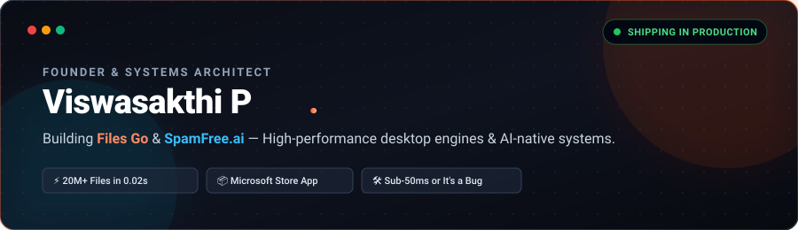
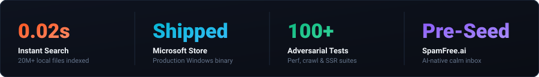

<div align="center">



<br/><br/>

<a href="https://filesgo.org">
  
</a>
<a href="https://apps.microsoft.com/detail/9PMPT8423QSC">
  
</a>
<a href="https://spamfree.ai">
  
</a>
<a href="mailto:viswasakthi.offl@gmail.com?subject=Investor%20%2F%20Collaboration%20Inquiry">
  
</a>

<br/><br/>



</div>

<br/>

---

### ⚡ The TL;DR

> *"Software is eating the world. It's time to build."*

I am **Viswasakthi P**, a founder, product architect, and systems engineer. I build high-throughput desktop software, low-latency search indexers, and AI-native operating environments. 

I don't build toy projects. I design, test, and ship end-to-end production software that solves acute consumer and enterprise bottlenecks:
* **Shipped a flagship Windows desktop suite to the Microsoft Store** with instant indexing over 20,000,000+ files in under 20 milliseconds.
* **Architecting SpamFree.ai**, an AI-native calm inbox moving email from manual triage to one-click contextual execution.
* **Engineered robust adversarial test suites (100+ tests)** covering SSR hydration, crawl integrity, schema validation, and sub-second IPC pipelines.

---

### 🚀 Flagship Ventures & Products

<table>
  <tr>
    <td width="55%" valign="top">
      <h3>01. Files Go — Ultra-Fast Windows 10 &amp; 11 File Manager</h3>
      <p><i>The modern replacement for Windows Explorer built for power users, creators, and developers.</i></p>
      <ul>
        <li><b>0.02s Sub-millisecond Indexer:</b> Searches 20M+ files instantaneously as you type without consuming excessive CPU/RAM.</li>
        <li><b>Keystroke Persistence Engine:</b> Background daemon that saves typed text across all desktop applications to prevent data loss.</li>
        <li><b>Spatial AI Canvas &amp; Voice Interaction:</b> Multimodal workspace where users speak to search, isolate, and manipulate files in real-time.</li>
        <li><b>Built-in Utilities:</b> 4K media engine, document inspect/preview, phone-as-trackpad remote control, and intelligent storage reclamation.</li>
      </ul>
      <p>
        <a href="https://filesgo.org"><b>🌐 Visit filesgo.org</b></a> &nbsp;•&nbsp; 
        <a href="https://apps.microsoft.com/detail/9PMPT8423QSC"><b>📦 View on Microsoft Store</b></a>
      </p>
    </td>
    <td width="45%" valign="top">
      <div align="center">
        
        
        <br/><br/>
        <b>Tech Stack:</b><br/>
        <code>TypeScript</code> · <code>TanStack Start (SSR)</code> · <code>Win32 API</code> · <code>Python Analytics</code> · <code>Bun</code> · <code>Tailwind CSS v4</code>
      </div>
    </td>
  </tr>
  <tr>
    <td width="55%" valign="top">
      <h3>02. SpamFree.ai — The Calm Inbox</h3>
      <p><i>AI that surfaces only what needs you — and quiets everything else.</i></p>
      <ul>
        <li><b>Contextual Action Chips:</b> Automatically classifies and parses incoming mail streams into actionable verbs (<code>Reply</code>, <code>Pay</code>, <code>Approve</code>, <code>Sign</code>).</li>
        <li><b>Noise Obliteration:</b> Separates machine-generated cold email spam from high-priority human communication.</li>
        <li><b>Privacy-Preserving Local Intelligence:</b> Structured LLM summarization pipeline designed for speed and data confidentiality.</li>
      </ul>
      <p>
        <a href="https://spamfree.ai"><b>🌐 spamfree.ai</b></a> &nbsp;•&nbsp; 
        <a href="mailto:viswasakthi.offl@gmail.com?subject=SpamFree.ai%20Deck%20Request"><b>📄 Request Pre-Seed Deck (₹3.5 Cr Round)</b></a>
      </p>
    </td>
    <td width="45%" valign="top">
      <div align="center">
        
        
        <br/><br/>
        <b>Tech Stack:</b><br/>
        <code>LLM Context Pipelines</code> · <code>Fast Vector Indexing</code> · <code>Real-time Parsing</code> · <code>TypeScript</code> · <code>Edge APIs</code>
      </div>
    </td>
  </tr>
</table>

---

### 🧠 Core Engineering Principles

```
┌────────────────────────────────────────────────────────────────────────┐
│ 01. LATENCY IS THE PRODUCT                                            │
│     If an interaction takes > 50ms, it breaks the illusion of direct   │
│     manipulation. Speed isn't an optimization; it's the core feature. │
├────────────────────────────────────────────────────────────────────────┤
│ 02. FULL-STACK SOVEREIGNTY                                            │
│     Real builders don't stop at the UI layer. We write native OS hooks,│
│     inverted indexes, IPC streaming channels, and SSR web clients.     │
├────────────────────────────────────────────────────────────────────────┤
│ 03. SHIPPED CODE > SLIDES                                              │
│     Theory is cheap. We measure velocity by working binaries in store  │
│     listings, live production deployments, and real user retention.    │
└────────────────────────────────────────────────────────────────────────┘
```

---

### 🛠️ Technical Arsenal

<table align="center">
  <tr>
    <td align="left"><b>Systems &amp; Desktop</b></td>
    <td>
      
      
      
      
    </td>
  </tr>
  <tr>
    <td align="left"><b>Web &amp; SSR Platforms</b></td>
    <td>
      
      
      
      
      
      
    </td>
  </tr>
  <tr>
    <td align="left"><b>AI &amp; Data Infrastructure</b></td>
    <td>
      
      
      
      
    </td>
  </tr>
</table>

---

### 📊 GitHub Velocity & Activity

<div align="center">
  
  
</div>

<br/>

---

### 🤝 Direct Channel for Investors, VCs &amp; Founders

I am actively building, shipping, and discussing early-stage venture backing for disruptive developer/consumer tools. If you are an investor at **a16z**, **Founders Fund**, **Sequoia**, an active angel, or a fellow technical founder:

* 📩 **Email:** [viswasakthi.offl@gmail.com](mailto:viswasakthi.offl@gmail.com?subject=Investor%20%2F%20Collaboration%20Inquiry%20from%20GitHub)
* 🌐 **Files Go:** [filesgo.org](https://filesgo.org)
* 📦 **Microsoft Store:** [Download App](https://apps.microsoft.com/detail/9PMPT8423QSC)
* 💡 **SpamFree:** [spamfree.ai](https://spamfree.ai)
* 📍 **Location:** India · Global First

<br/>

<div align="center">
  <sub>Crafted for speed, built for scale. © 2026 Viswasakthi P</sub>
</div>
